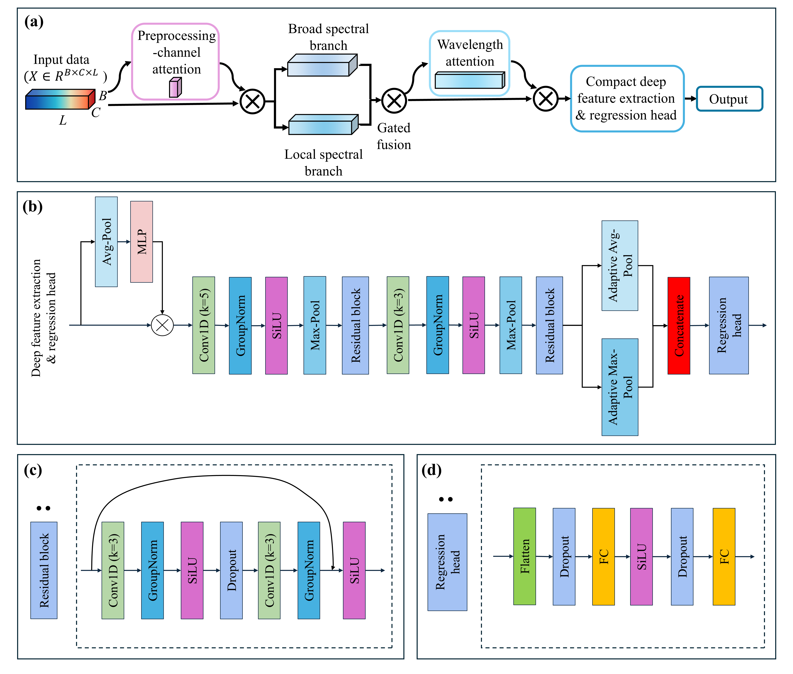

# IDASNet

Implementation of **IDASNet: An Interpretable Dual-Attention Spectral Network for Hyperspectral Prediction of Grape Total Soluble Solids**. The model predicts grape TSS (°Brix) from five preprocessed spectral channels using preprocessing-method and wavelength attention.



## Setup

Use Python 3.12 and a PyTorch build suitable for your CPU or CUDA environment:

```bash
python -m pip install -r requirements.txt
```

## Data

This is a code-only release. Images, spectra, reference measurements, prepared datasets and trained weights are not included. Study data are available on request through the corresponding author listed in the article.

Training expects an unsplit, unnormalized PyTorch dictionary saved as `raw.pt`:

| Key | Content |
| --- | --- |
| `X` | Float tensor shaped `(N, 5, 151)` |
| `y["TSS"]` | Float tensor with one reference value per berry |
| `metadata` | Lists `global_ids` (unique berry IDs), `acquisition_ids` (whole-cluster IDs) and `dates` (`YYYYMMDD`), each of length N |
| `processing_methods` | `reflectance_SG`, `reflectance_SGder`, `reflectance_SG+SNV`, `reflectance_SGder+SNV`, `reflectance_SNV`, in that order |
| `wavelengths` | `list(range(350, 1101, 5))` |

Values must be finite. All berries from one physical cluster must share an acquisition ID so they stay in the same fold. Input normalization is applied by the training and inference code.

To construct this file from dark-corrected NH7 signals and LabelMe annotations:

```bash
python data/build.py --input-root data/raw --dates DATE_DIRECTORY_1 DATE_DIRECTORY_2
```

Each date directory contains `nh7/<name>.nh7`, `json/<name>.json`, `whiteboard/<name>.json` and `brix/MHAM.csv`. NH7 files are headerless uint16 arrays shaped `(1024, 151, 1280)`; image and annotation stems must match. The builder writes `data/generated/raw.pt`. Keep data, weights and experiment outputs out of the source release, including ZIP archives.

## Experiments

Run experiments individually from the repository root. Start with IDASNet to save the dataset snapshot, outer partitions and selected parameters:

```bash
python idasnet/evaluate.py --raw-pt data/generated/raw.pt --result-root results/IDASNet --device cpu
```

Then run the desired model comparisons and analyses through the entry points below. Run attention ablations before the channel/wavelength-combination experiments. Use `--device cuda` for GPU training and choose a worker count suitable for available memory.

| Experiment | Entry point |
| --- | --- |
| IDASNet | `idasnet/evaluate.py` |
| 1D-CNN / ResNet1D | `baselines/cnn1d.py`, `baselines/resnet1d.py` |
| PLSR / RF / SVR | `baselines/plsr.py`, `baselines/rf.py`, `baselines/svr.py` |
| Attention ablations | `experiments/ablation.py` |
| Channel/wavelength combinations | `experiments/joint_inputs.py` |
| Input-masking sensitivity | `experiments/sensitivity.py` |

Use `--help` for individual arguments and explicit training-budget overrides. Baselines and analyses reuse the IDASNet dataset snapshot and outer partitions. Main and baseline runs support `--resume-dir`; attention ablation and input-combination runs support `--resume` and `--summarize`. Saved data, partitions and settings must match when resuming. Outputs include predictions, metrics, selected parameters, attention weights and statistical comparisons as numerical files. Saved PLSR/RF/SVR pipelines accept unnormalized spectra flattened to `(N, 5*151)`; load them from the repository root with `joblib.load(path)["model"]`.

Shared training defaults are in [idasnet/protocol.py](idasnet/protocol.py): 5 × 5 grouped outer cross-validation, 4 inner folds, 30 neural search trials, at most 500 epochs, patience 50, batch size 8 and final seeds 0–9. Model search spaces follow Table S2 and are defined in [idasnet/model.py](idasnet/model.py), [baselines/neural_models.py](baselines/neural_models.py) and the respective PLSR/RF/SVR modules. Preprocessing and normalization settings are in `data/build.py` and `data/__init__.py`. Each run saves its settings for resume checks.

Neural-network predictions are averaged across seeds before evaluation; metrics are computed within each repetition and summarized as mean ± sample SD. [idasnet/statistics.py](idasnet/statistics.py) implements whole-cluster bootstrap intervals (2,000 draws) and paired cluster-level Wilcoxon tests. Compact-input experiments normalize full spectra before cropping; their fixed global attention rankings use the same dataset, so they do not independently validate feature selection.

## Inference and interactive application

```bash
python idasnet/inference.py --checkpoints PATH_TO_CHECKPOINT --spectra PATH_TO_SPECTRA_NPZ --output results/predictions.csv
```

The NPZ must contain unnormalized `X`, `processing_methods` and `wavelengths`; optional `sample_ids` and other string arrays must use Unicode rather than object dtype. Multiple checkpoints can be supplied for prediction averaging. Compact checkpoints apply their saved input selection after normalization.

The optional `applications/interactive.py` combines point-prompted SAM segmentation, TSS prediction and KDE visualization. It requires a desktop with Tk support, a calibrated reflectance `.npy` cube shaped `(height, width, 151)`, IDASNet checkpoints and a matching SAM checkpoint. Follow the [official Segment Anything installation instructions](https://github.com/facebookresearch/segment-anything); external weights are supplied separately. NumPy sample/white/dark calibration is available in `data/calibrate.py`.

```bash
python applications/interactive.py --cube reflectance.npy --checkpoints PATH_TO_IDASNET_CHECKPOINT --sam-checkpoint PATH_TO_SAM_CHECKPOINT --sam-model vit_b --output results/interactive --device cpu
```

Click berry centres and check the segmentation masks before interpreting predictions. KDE summarizes predicted TSS values.

## License

Code is distributed under the [MIT license](LICENSE). SAM is an optional external dependency with its own license and pretrained weights.
